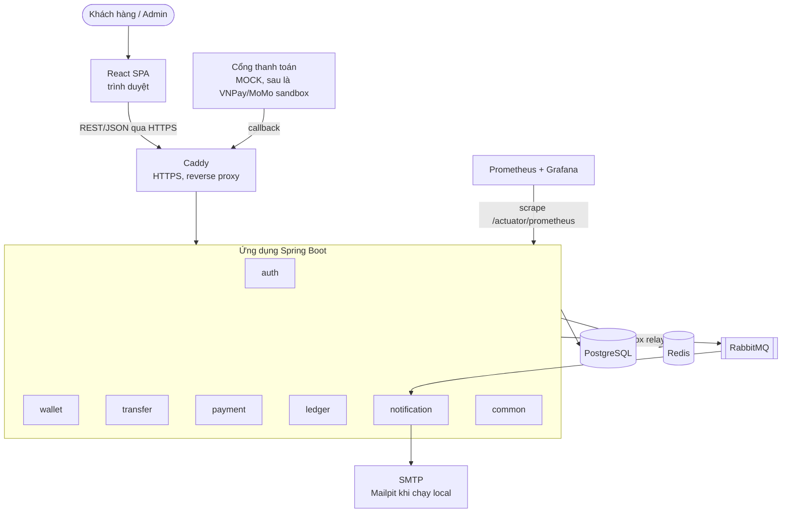
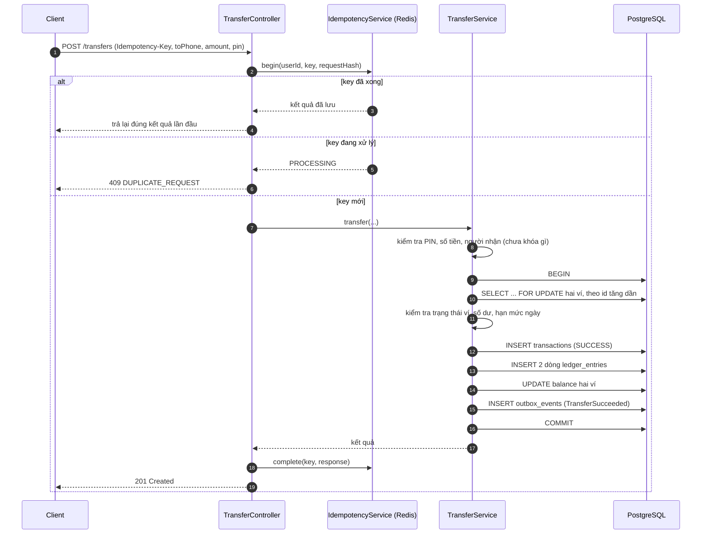
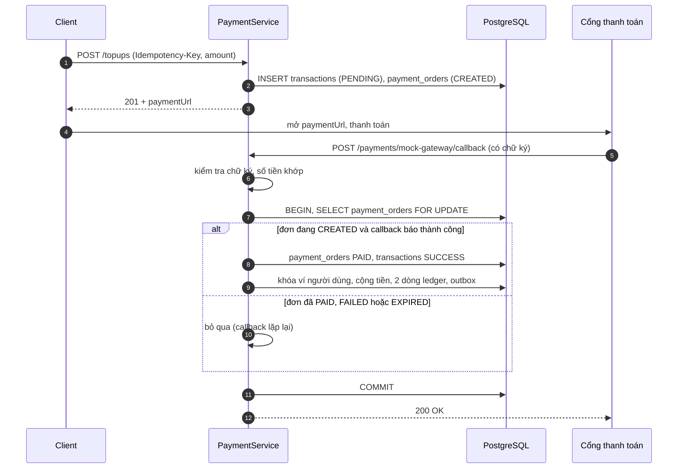
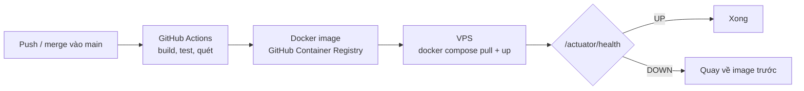

# Kiến trúc Mini Wallet

Mini Wallet là một **modular monolith**: một ứng dụng Spring Boot chia module theo nghiệp vụ, dùng chung một PostgreSQL, Redis cho idempotency và rate limit, RabbitMQ cho sự kiện. Lý do chọn kiến trúc này nằm ở ADR 0001.

Tài liệu liên quan: [PRD](PRD.md) · [Database](database.md) · [OpenAPI](openapi.yaml) · [ADR](adr/)

## 1. Tổng quan hệ thống



## 2. Module

| Module | Trách nhiệm | Được gọi bởi |
| --- | --- | --- |
| `auth` | Đăng ký, đăng nhập, JWT, refresh token, mã PIN | Controller, `transfer` (kiểm tra PIN) |
| `wallet` | Tạo ví, đọc số dư, khóa/mở ví, khóa dòng ví khi chuyển tiền | `auth` (tạo ví khi đăng ký), `transfer`, `payment` |
| `transfer` | Chuyển tiền: kiểm tra nghiệp vụ, hạn mức, điều phối transaction | Controller |
| `payment` | Lệnh nạp tiền, gọi cổng thanh toán, xử lý callback, hết hạn lệnh treo | Controller, job |
| `ledger` | Ghi dòng sổ cái, đối soát | `transfer`, `payment`, job |
| `notification` | Nhận sự kiện từ RabbitMQ, gửi email | RabbitMQ listener |
| `common` | Xử lý lỗi, idempotency, logging, cấu hình, tiện ích thời gian và tiền | Mọi module |

Quy tắc phụ thuộc:

1. Module chỉ gọi module khác qua service công khai trong package `api` hoặc `application` của nó, không đụng repository hay entity của module khác.
2. Không có phụ thuộc vòng. `wallet` và `ledger` không biết gì về `transfer` hay `payment`.
3. Kiểm tra quy tắc 1 và 2 bằng test ArchUnit hoặc Spring Modulith (`ApplicationModules.verify()`) chạy trong CI.

Cấu trúc package mỗi module:

```
com.khoaphamlee.wallet.transfer
  api/            TransferController, TransferRequest, TransactionResponse
  application/    TransferService (điều phối, @Transactional)
  domain/         TransferPolicy (quy tắc hạn mức, số tiền), các exception nghiệp vụ
  infra/          TransactionRepository, truy vấn đặc thù
```

## 3. Luồng chuyển tiền



Các điểm quan trọng:

- **Kiểm tra rẻ trước, khóa sau.** PIN, số tiền, tự chuyển cho mình được kiểm tra trước khi mở khóa, để không giữ khóa lâu.
- **Kiểm tra số dư và hạn mức sau khi khóa.** Kiểm tra trước khi khóa là sai, vì giữa lúc đọc và lúc ghi có thể có request khác chen vào.
- **Thứ tự khóa cố định.** Luôn khóa ví có id nhỏ hơn trước. A chuyển B và B chuyển A cùng lúc vẫn không deadlock (ADR 0003).
- **Timeout khóa.** Đặt `jakarta.persistence.lock.timeout` khoảng 3 giây. Hết thời gian chờ thì trả lỗi tạm thời (503, `SERVICE_BUSY`) thay vì treo request.
- **Lỗi trong transaction.** Mọi exception làm rollback toàn bộ. Không có trạng thái nửa vời: hoặc đủ giao dịch, ledger, số dư, outbox, hoặc không có gì.
- **Khi có lỗi.** Mọi request lỗi đều không trừ tiền, nên key trong Redis bị xóa để client gửi lại được (xem mục 5).

## 4. Luồng nạp tiền



- Callback có thể đến nhiều lần hoặc đến muộn. Khóa dòng `payment_orders` rồi kiểm tra trạng thái giúp chỉ cộng tiền đúng một lần.
- Luôn trả 200 cho callback hợp lệ, kể cả khi bỏ qua, để cổng thanh toán không gửi lại mãi.
- Ví hệ thống `SYSTEM_TOPUP` chỉ được ghi dòng ledger, không bị khóa (ADR 0005).
- Job chạy mỗi phút chuyển các đơn `CREATED` đã quá `expires_at` sang `EXPIRED`, giao dịch tương ứng sang `FAILED`.

**Cổng thanh toán giả lập (MOCK)** là một controller trong chính ứng dụng, chỉ bật ở profile `local` và `demo`:

- `GET /mock-gateway/pay/{orderId}` hiện trang có nút "Thanh toán thành công" và "Thất bại".
- Bấm nút thì gọi callback với chữ ký `HMAC-SHA256(secret, orderId|providerRef|amount|status)`, giống cách VNPay và MoMo ký.
- Nhờ dùng cùng giao thức, sau này thay bằng sandbox thật chỉ cần viết thêm một `PaymentGatewayClient`.

## 5. Idempotency

Áp dụng cho `POST /topups` và `POST /transfers`.

| Bước | Hành động |
| --- | --- |
| 1 | Đọc header `Idempotency-Key` (UUID). Thiếu thì trả 400 `IDEMPOTENCY_KEY_REQUIRED` |
| 2 | Tính `requestHash = SHA-256(nội dung request đã chuẩn hóa)`, bỏ trường `pin` ra khỏi phép băm |
| 3 | `SET idem:{userId}:{key} {"status":"PROCESSING","hash":...} NX EX 60`. TTL ngắn để nếu app sập giữa chừng, key không bị kẹt ở `PROCESSING` cả ngày |
| 4 | Set thành công: xử lý request. Xong thì ghi `{"status":"DONE","hash":...,"httpStatus":...,"body":...}` với `EX 86400` |
| 5 | Set thất bại: đọc giá trị. Hash khác thì 422 `IDEMPOTENCY_KEY_REUSED`. `PROCESSING` thì 409 `DUPLICATE_REQUEST`. `DONE` thì trả lại `httpStatus` và `body` đã lưu |
| 6 | Chỉ lưu `DONE` khi thành công (2xx). Gặp lỗi bất kỳ (4xx hoặc 5xx) thì xóa key, để người dùng sửa lỗi (nhập lại PIN, nạp thêm tiền) rồi gửi lại với cùng key. Không có rủi ro trừ tiền hai lần vì request lỗi không trừ tiền |

Lớp bảo vệ thứ hai: `UNIQUE (created_by, idempotency_key)` trên `transactions`. Nếu Redis mất dữ liệu, hoặc app sập sau khi commit nhưng trước khi kịp ghi `DONE`, lần gửi lại sẽ vi phạm ràng buộc này. Khi đó service đọc giao dịch đã có theo `(created_by, idempotency_key)` và trả lại nó, thay vì báo lỗi.

Phía frontend: tạo `Idempotency-Key` một lần khi mở form, giữ nguyên khi người dùng bấm lại hoặc khi tự retry, tạo key mới sau khi giao dịch xong.

## 6. Bảo mật

| Chủ đề | Thiết kế |
| --- | --- |
| Xác thực | JWT access token (15 phút, ký HS256 bằng secret từ biến môi trường). Refresh token ngẫu nhiên 256 bit, lưu hash trong `refresh_tokens`, dùng một lần (xoay vòng) |
| Phân quyền | Role `CUSTOMER`, `ADMIN`. `/api/v1/admin/**` chỉ cho `ADMIN`. Dữ liệu luôn lọc theo `userId` lấy từ token, không bao giờ lấy từ request |
| Mật khẩu, PIN | BCrypt (cost 10). PIN sai 5 lần khóa 15 phút (BR-06) |
| Rate limit | Bucket4j trên Redis: đăng nhập 5/phút mỗi IP, chuyển tiền 10/phút mỗi người dùng. Vượt thì 429 `RATE_LIMITED` |
| Callback | Chỉ chấp nhận khi chữ ký HMAC hợp lệ và số tiền khớp `payment_orders.amount` |
| CORS | Chỉ cho domain của frontend |
| Log | Không ghi mật khẩu, PIN, token, nội dung header `Authorization` |
| Audit | Ghi `audit_logs` khi đăng nhập (thành công và thất bại), đổi PIN, khóa/mở ví |

## 7. Xử lý lỗi

Mọi lỗi trả về theo chuẩn Problem Details (RFC 9457), Content-Type `application/problem+json`, có thêm `code` và `traceId`:

```json
{
  "type": "https://wallet.example.com/errors/insufficient-balance",
  "title": "Insufficient balance",
  "status": 422,
  "detail": "Số dư không đủ để thực hiện giao dịch",
  "instance": "/api/v1/transfers",
  "code": "INSUFFICIENT_BALANCE",
  "traceId": "6f1c2a9b8e7d4c3b"
}
```

| Mã lỗi | HTTP |
| --- | --- |
| `VALIDATION_ERROR`, `IDEMPOTENCY_KEY_REQUIRED` | 400 |
| `INVALID_CREDENTIALS`, `INVALID_TOKEN` | 401 |
| `INVALID_PIN`, `PIN_LOCKED`, `PIN_NOT_SET`, `WALLET_LOCKED`, `ACCESS_DENIED` | 403 |
| `RECIPIENT_NOT_FOUND`, `TRANSACTION_NOT_FOUND`, `WALLET_NOT_FOUND` | 404 |
| `EMAIL_ALREADY_EXISTS`, `PHONE_ALREADY_EXISTS`, `DUPLICATE_REQUEST` | 409 |
| `INSUFFICIENT_BALANCE`, `DAILY_LIMIT_EXCEEDED`, `AMOUNT_OUT_OF_RANGE`, `SELF_TRANSFER_NOT_ALLOWED`, `IDEMPOTENCY_KEY_REUSED` | 422 |
| `RATE_LIMITED` | 429 |
| `INTERNAL_ERROR` | 500 |
| `SERVICE_BUSY` | 503 |

Lỗi HTTP chung do Spring tự sinh (405, 415, JSON không đọc được...) giữ nguyên status. Lỗi 400 dùng `code` là `VALIDATION_ERROR`, các status khác dùng tên HTTP status, ví dụ `METHOD_NOT_ALLOWED`.

Một `@RestControllerAdvice` duy nhất trong `common` map exception sang bảng trên. Exception nghiệp vụ kế thừa một lớp `BusinessException` mang sẵn `ErrorCode`.

## 8. Logging và quan sát

- Log JSON (structured logging của Spring Boot), mỗi dòng có `traceId`, `spanId`, `userId` nếu đã đăng nhập.
- Header `X-Trace-Id` trả về trong mọi response để tra log khi người dùng báo lỗi.
- Metrics qua Micrometer, xuất `/actuator/prometheus` (chỉ mở trong mạng nội bộ).
- Metrics nghiệp vụ tự định nghĩa: `wallet_transfers_total{result}`, `wallet_topups_total{result}`, `wallet_transfer_amount_sum`, `wallet_reconciliation_mismatches`.

## 9. Job nền

| Job | Lịch | Việc làm |
| --- | --- | --- |
| Outbox relay | Mỗi 2 giây | Lấy tối đa 100 sự kiện `NEW` bằng `FOR UPDATE SKIP LOCKED`, gửi RabbitMQ, đánh dấu `SENT` |
| Hết hạn lệnh nạp | Mỗi phút | `payment_orders` quá `expires_at` thành `EXPIRED`, giao dịch thành `FAILED` |
| Đối soát | 02:00 hằng ngày (giờ Việt Nam) | So `balance` với tổng ledger mỗi ví, kiểm tra tổng toàn hệ thống bằng 0, tính lại số dư ví hệ thống |

Ứng dụng chạy một instance nên `@Scheduled` là đủ. Khi chạy nhiều instance thì thêm ShedLock để mỗi job chỉ chạy ở một nơi.

## 10. Triển khai



Trên VPS, `docker-compose.yml` gồm: `caddy`, `backend`, `frontend` (Nginx phục vụ file tĩnh), `postgres`, `redis`, `rabbitmq`, `prometheus`, `grafana`. Chỉ `caddy` mở cổng 80 và 443 ra ngoài.

| Môi trường | Spring profile | Ghi chú |
| --- | --- | --- |
| Máy local | `local` | docker-compose chỉ chạy hạ tầng, backend chạy trong IDE. Bật cổng thanh toán giả lập, Mailpit |
| CI | `test` | Testcontainers dựng PostgreSQL, Redis, RabbitMQ |
| VPS | `prod` | Secrets qua biến môi trường. Cổng giả lập bật bằng profile `demo` để người xem thử được |

## 11. Đáp ứng yêu cầu phi chức năng

| NFR | Thiết kế đáp ứng |
| --- | --- |
| NFR-1 Số dư đúng khi đồng thời | Pessimistic lock theo thứ tự, `CHECK (balance >= 0)` |
| NFR-2 Không trừ hai lần | Idempotency trên Redis, `UNIQUE (created_by, idempotency_key)` |
| NFR-3, NFR-4 Hiệu năng | Transaction ngắn, kiểm tra rẻ trước khi khóa, index theo ví và thời gian |
| NFR-5, NFR-6 Bảo mật | BCrypt, JWT, lọc dữ liệu theo `userId` từ token |
| NFR-7 Truy vết | Sổ cái ghi sổ kép chỉ INSERT, job đối soát |
| NFR-8 Vận hành | Actuator, Prometheus, log JSON có `traceId` |
