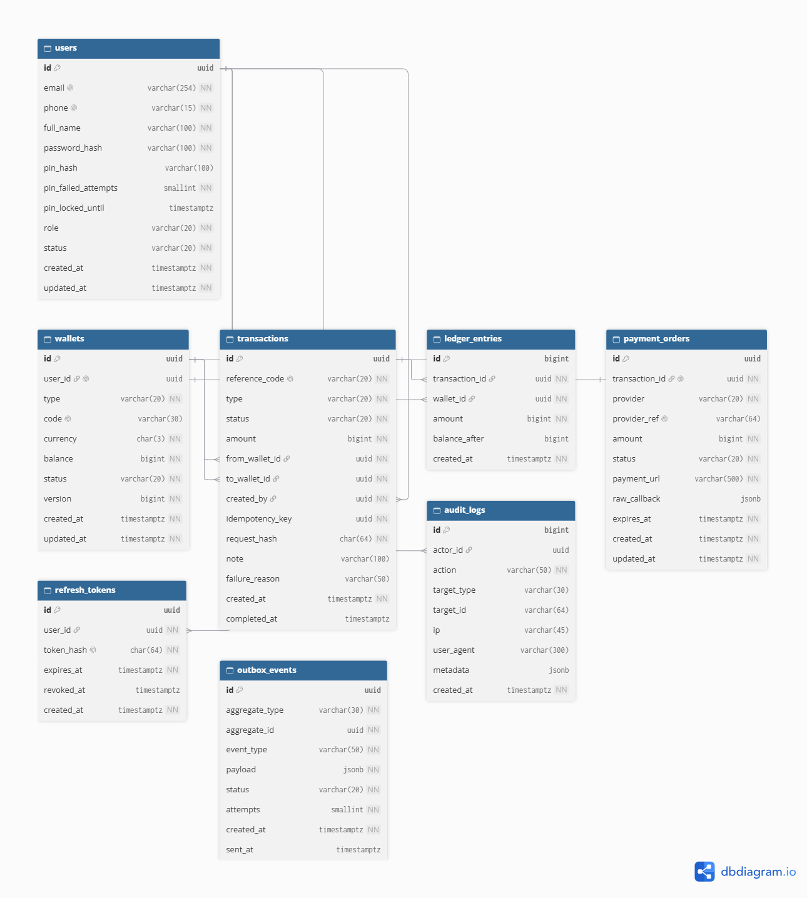

# Thiết kế database

PostgreSQL. Schema chỉ thay đổi qua migration Flyway (`backend/src/main/resources/db/migration`), `ddl-auto=validate`.

Quy ước chung:

- Tên bảng, tên cột dạng `snake_case`, tên bảng số nhiều.
- Khóa chính nghiệp vụ dùng `UUID` (không lộ số lượng bản ghi qua id tăng dần). Bảng chỉ ghi thêm và nhiều dòng (`ledger_entries`, `audit_logs`) dùng `BIGINT GENERATED ALWAYS AS IDENTITY`.
- Thời gian dùng `TIMESTAMPTZ`, lưu UTC.
- Tiền dùng `BIGINT`, đơn vị đồng (ADR 0002).
- Giá trị liệt kê (status, type) lưu `VARCHAR` kèm `CHECK`, map sang `enum` Java bằng `@Enumerated(EnumType.STRING)`.

## Sơ đồ quan hệ


Dán khối DBML ở cuối file vào [dbdiagram.io](https://dbdiagram.io) để xem và xuất ảnh ERD.

```
users 1 ── 0..1 wallets
users 1 ── n    refresh_tokens
wallets 1 ── n  ledger_entries
transactions 1 ── n ledger_entries      (thành công thì đúng 2 dòng)
transactions 1 ── 0..1 payment_orders   (chỉ với TOPUP)
wallets 1 ── n  transactions            (qua from_wallet_id, to_wallet_id)
```

## Các bảng

### users

| Cột | Kiểu | Ràng buộc | Ghi chú |
| --- | --- | --- | --- |
| id | UUID | PK | |
| email | VARCHAR(254) | NOT NULL, UNIQUE | Lưu dạng chữ thường |
| phone | VARCHAR(15) | NOT NULL, UNIQUE | Chuẩn hóa về dạng `+84...` |
| full_name | VARCHAR(100) | NOT NULL | |
| password_hash | VARCHAR(100) | NOT NULL | BCrypt |
| pin_hash | VARCHAR(100) | NULL | NULL = chưa đặt PIN |
| pin_failed_attempts | SMALLINT | NOT NULL, DEFAULT 0 | |
| pin_locked_until | TIMESTAMPTZ | NULL | |
| role | VARCHAR(20) | NOT NULL, CHECK IN (`CUSTOMER`, `ADMIN`) | |
| status | VARCHAR(20) | NOT NULL, CHECK IN (`ACTIVE`, `DISABLED`) | |
| created_at | TIMESTAMPTZ | NOT NULL | |
| updated_at | TIMESTAMPTZ | NOT NULL | |

### wallets

| Cột | Kiểu | Ràng buộc | Ghi chú |
| --- | --- | --- | --- |
| id | UUID | PK | |
| user_id | UUID | NULL, UNIQUE, FK → users.id | NULL với ví hệ thống |
| type | VARCHAR(20) | NOT NULL, CHECK IN (`USER`, `SYSTEM`) | |
| code | VARCHAR(30) | NULL, UNIQUE | Chỉ ví hệ thống có, ví dụ `SYSTEM_TOPUP` |
| currency | CHAR(3) | NOT NULL, DEFAULT `VND` | |
| balance | BIGINT | NOT NULL, DEFAULT 0 | |
| status | VARCHAR(20) | NOT NULL, CHECK IN (`ACTIVE`, `LOCKED`) | |
| version | BIGINT | NOT NULL, DEFAULT 0 | Cho optimistic locking ở các thao tác không phải chuyển tiền |
| created_at | TIMESTAMPTZ | NOT NULL | |
| updated_at | TIMESTAMPTZ | NOT NULL | |

Ràng buộc bảng:

- `CHECK (type = 'SYSTEM' OR balance >= 0)`: số dư ví khách hàng không được âm (BR-02). Ví hệ thống được phép âm (ADR 0005).
- `CHECK ((type = 'USER' AND user_id IS NOT NULL) OR (type = 'SYSTEM' AND code IS NOT NULL))`.

### transactions

| Cột | Kiểu | Ràng buộc | Ghi chú |
| --- | --- | --- | --- |
| id | UUID | PK | |
| reference_code | VARCHAR(20) | NOT NULL, UNIQUE | Mã dễ đọc cho người dùng, ví dụ `TX2611090001A3F` |
| type | VARCHAR(20) | NOT NULL, CHECK IN (`TOPUP`, `TRANSFER`) | |
| status | VARCHAR(20) | NOT NULL, CHECK IN (`PENDING`, `SUCCESS`, `FAILED`) | |
| amount | BIGINT | NOT NULL, CHECK (amount > 0) | |
| from_wallet_id | UUID | NOT NULL, FK → wallets.id | Với TOPUP là ví `SYSTEM_TOPUP` |
| to_wallet_id | UUID | NOT NULL, FK → wallets.id | |
| created_by | UUID | NOT NULL, FK → users.id | Người tạo giao dịch |
| idempotency_key | UUID | NOT NULL | |
| request_hash | CHAR(64) | NOT NULL | SHA-256 của nội dung request, để phát hiện dùng lại key với nội dung khác |
| note | VARCHAR(100) | NULL | |
| failure_reason | VARCHAR(50) | NULL | Mã lỗi khi `FAILED` |
| created_at | TIMESTAMPTZ | NOT NULL | |
| completed_at | TIMESTAMPTZ | NULL | Thời điểm sang `SUCCESS` hoặc `FAILED` |

Ràng buộc bảng:

- `UNIQUE (created_by, idempotency_key)`: lớp bảo vệ thứ hai cho idempotency, sau Redis.
- `CHECK (from_wallet_id <> to_wallet_id)`.

Chỉ lưu giao dịch đã qua bước kiểm tra nghiệp vụ. Request bị từ chối ngay (sai PIN, thiếu số dư) không tạo bản ghi, chỉ ghi log và trả lỗi.

### ledger_entries

| Cột | Kiểu | Ràng buộc | Ghi chú |
| --- | --- | --- | --- |
| id | BIGINT | PK, identity | |
| transaction_id | UUID | NOT NULL, FK → transactions.id | |
| wallet_id | UUID | NOT NULL, FK → wallets.id | |
| amount | BIGINT | NOT NULL, CHECK (amount <> 0) | Âm là trừ, dương là cộng |
| balance_after | BIGINT | NULL | Số dư ví sau dòng này. NULL với ví hệ thống |
| created_at | TIMESTAMPTZ | NOT NULL | |

Ràng buộc bảng:

- `UNIQUE (transaction_id, wallet_id)`: một giao dịch không ghi hai dòng cho cùng một ví.
- Bảng chỉ INSERT. Ứng dụng không có code UPDATE hay DELETE bảng này. Muốn chắc hơn: tạo user database riêng cho ứng dụng và `REVOKE UPDATE, DELETE ON ledger_entries`.

Bất biến: với mỗi giao dịch `SUCCESS`, tổng `amount` các dòng của nó bằng 0. Suy ra tổng `amount` của cả bảng luôn bằng 0.

### payment_orders

| Cột | Kiểu | Ràng buộc | Ghi chú |
| --- | --- | --- | --- |
| id | UUID | PK | Mã đơn gửi sang cổng thanh toán (`orderId`) |
| transaction_id | UUID | NOT NULL, UNIQUE, FK → transactions.id | |
| provider | VARCHAR(20) | NOT NULL, CHECK IN (`MOCK`, `VNPAY`, `MOMO`) | MVP chỉ dùng `MOCK` |
| provider_ref | VARCHAR(64) | NULL, UNIQUE | Mã giao dịch phía cổng thanh toán, có khi callback về |
| amount | BIGINT | NOT NULL | Đối chiếu với số tiền trong callback |
| status | VARCHAR(20) | NOT NULL, CHECK IN (`CREATED`, `PAID`, `FAILED`, `EXPIRED`) | |
| payment_url | VARCHAR(500) | NOT NULL | |
| raw_callback | JSONB | NULL | Lưu nguyên callback cuối cùng để tra soát |
| expires_at | TIMESTAMPTZ | NOT NULL | created_at + 15 phút (BR-09) |
| created_at | TIMESTAMPTZ | NOT NULL | |
| updated_at | TIMESTAMPTZ | NOT NULL | |

### refresh_tokens

| Cột | Kiểu | Ràng buộc | Ghi chú |
| --- | --- | --- | --- |
| id | UUID | PK | |
| user_id | UUID | NOT NULL, FK → users.id | |
| token_hash | CHAR(64) | NOT NULL, UNIQUE | SHA-256 của token, không lưu token gốc |
| expires_at | TIMESTAMPTZ | NOT NULL | created_at + 7 ngày |
| revoked_at | TIMESTAMPTZ | NULL | Đặt khi đăng xuất hoặc khi token đã được dùng để làm mới |
| created_at | TIMESTAMPTZ | NOT NULL | |

### outbox_events

| Cột | Kiểu | Ràng buộc | Ghi chú |
| --- | --- | --- | --- |
| id | UUID | PK | Bên nhận dùng làm khóa chống xử lý trùng |
| aggregate_type | VARCHAR(30) | NOT NULL | Ví dụ `TRANSACTION` |
| aggregate_id | UUID | NOT NULL | |
| event_type | VARCHAR(50) | NOT NULL | Ví dụ `TransferSucceeded`, `TopupSucceeded` |
| payload | JSONB | NOT NULL | |
| status | VARCHAR(20) | NOT NULL, CHECK IN (`NEW`, `SENT`, `FAILED`) | |
| attempts | SMALLINT | NOT NULL, DEFAULT 0 | Quá 10 lần thì chuyển `FAILED` để xem tay |
| created_at | TIMESTAMPTZ | NOT NULL | |
| sent_at | TIMESTAMPTZ | NULL | |

### audit_logs

| Cột | Kiểu | Ràng buộc | Ghi chú |
| --- | --- | --- | --- |
| id | BIGINT | PK, identity | |
| actor_id | UUID | NULL, FK → users.id | NULL khi là job hệ thống |
| action | VARCHAR(50) | NOT NULL | `LOGIN_SUCCESS`, `LOGIN_FAILED`, `PIN_CHANGED`, `WALLET_LOCKED`, ... |
| target_type | VARCHAR(30) | NULL | |
| target_id | VARCHAR(64) | NULL | |
| ip | VARCHAR(45) | NULL | Đủ cho IPv6 |
| user_agent | VARCHAR(300) | NULL | |
| metadata | JSONB | NULL | Ví dụ lý do khóa ví. Không ghi mật khẩu, PIN, token |
| created_at | TIMESTAMPTZ | NOT NULL | |

## Index

| Index | Phục vụ |
| --- | --- |
| `transactions (from_wallet_id, created_at DESC)` | Lịch sử tiền ra, tính hạn mức ngày (BR-05) |
| `transactions (to_wallet_id, created_at DESC)` | Lịch sử tiền vào |
| `transactions (status, created_at) WHERE status = 'PENDING'` | Job hủy giao dịch treo (partial index, rất nhỏ) |
| `ledger_entries (wallet_id, id)` | Sổ cái theo ví, job đối soát |
| `payment_orders (status, expires_at) WHERE status = 'CREATED'` | Job hết hạn lệnh nạp |
| `outbox_events (created_at) WHERE status = 'NEW'` | Job gửi sự kiện |
| `refresh_tokens (user_id)` | Thu hồi toàn bộ token của một người |
| `audit_logs (actor_id, created_at DESC)` | Tra lịch sử thao tác của một người |

Các cột `UNIQUE` đã tự có index. Lịch sử giao dịch của một ví = hai truy vấn theo hai index đầu, gộp bằng `UNION ALL` rồi sắp xếp, hoặc một truy vấn `WHERE from_wallet_id = :id OR to_wallet_id = :id`. Đo bằng `EXPLAIN ANALYZE` ở tuần 8 để chọn cách nhanh hơn, ghi kết quả vào `docs/performance.md`.

## Ghi chú thiết kế

1. **Hai ràng buộc chống sai số dư ở database.** Ứng dụng đã khóa và kiểm tra số dư, nhưng `CHECK (balance >= 0)` vẫn chặn được lỗi code nếu có. Cái gì database tự đảm bảo được thì để database đảm bảo.
2. **Ví hệ thống không bị khóa khi nạp tiền.** Nếu mỗi lệnh nạp đều khóa dòng `SYSTEM_TOPUP`, mọi lệnh nạp phải xếp hàng qua một dòng duy nhất. Vì vậy ví hệ thống chỉ được ghi dòng ledger, cột `balance` của nó không cập nhật theo thời gian thực mà do job đối soát tính lại (ADR 0005).
3. **Không xóa cứng dữ liệu tiền.** Không có `ON DELETE CASCADE` trên các khóa ngoại liên quan đến giao dịch và sổ cái.
4. **Thời điểm tính hạn mức ngày.** Ngày được tính theo giờ Việt Nam: khoảng `[00:00, 24:00) Asia/Ho_Chi_Minh` đổi sang UTC trước khi truy vấn.

## DBML cho dbdiagram.io

```dbml
Table users {
  id uuid [pk]
  email varchar(254) [not null, unique]
  phone varchar(15) [not null, unique]
  full_name varchar(100) [not null]
  password_hash varchar(100) [not null]
  pin_hash varchar(100)
  pin_failed_attempts smallint [not null, default: 0]
  pin_locked_until timestamptz
  role varchar(20) [not null, note: 'CUSTOMER | ADMIN']
  status varchar(20) [not null, note: 'ACTIVE | DISABLED']
  created_at timestamptz [not null]
  updated_at timestamptz [not null]
}

Table wallets {
  id uuid [pk]
  user_id uuid [unique, ref: - users.id]
  type varchar(20) [not null, note: 'USER | SYSTEM']
  code varchar(30) [unique, note: 'SYSTEM_TOPUP']
  currency char(3) [not null, default: 'VND']
  balance bigint [not null, default: 0]
  status varchar(20) [not null, note: 'ACTIVE | LOCKED']
  version bigint [not null, default: 0]
  created_at timestamptz [not null]
  updated_at timestamptz [not null]
  Note: 'CHECK (type = SYSTEM OR balance >= 0)'
}

Table transactions {
  id uuid [pk]
  reference_code varchar(20) [not null, unique]
  type varchar(20) [not null, note: 'TOPUP | TRANSFER']
  status varchar(20) [not null, note: 'PENDING | SUCCESS | FAILED']
  amount bigint [not null]
  from_wallet_id uuid [not null, ref: > wallets.id]
  to_wallet_id uuid [not null, ref: > wallets.id]
  created_by uuid [not null, ref: > users.id]
  idempotency_key uuid [not null]
  request_hash char(64) [not null]
  note varchar(100)
  failure_reason varchar(50)
  created_at timestamptz [not null]
  completed_at timestamptz
  indexes {
    (created_by, idempotency_key) [unique]
    (from_wallet_id, created_at)
    (to_wallet_id, created_at)
  }
}

Table ledger_entries {
  id bigint [pk, increment]
  transaction_id uuid [not null, ref: > transactions.id]
  wallet_id uuid [not null, ref: > wallets.id]
  amount bigint [not null, note: 'am = tru, duong = cong']
  balance_after bigint
  created_at timestamptz [not null]
  indexes {
    (transaction_id, wallet_id) [unique]
    (wallet_id, id)
  }
}

Table payment_orders {
  id uuid [pk]
  transaction_id uuid [not null, unique, ref: - transactions.id]
  provider varchar(20) [not null, note: 'MOCK | VNPAY | MOMO']
  provider_ref varchar(64) [unique]
  amount bigint [not null]
  status varchar(20) [not null, note: 'CREATED | PAID | FAILED | EXPIRED']
  payment_url varchar(500) [not null]
  raw_callback jsonb
  expires_at timestamptz [not null]
  created_at timestamptz [not null]
  updated_at timestamptz [not null]
}

Table refresh_tokens {
  id uuid [pk]
  user_id uuid [not null, ref: > users.id]
  token_hash char(64) [not null, unique]
  expires_at timestamptz [not null]
  revoked_at timestamptz
  created_at timestamptz [not null]
}

Table outbox_events {
  id uuid [pk]
  aggregate_type varchar(30) [not null]
  aggregate_id uuid [not null]
  event_type varchar(50) [not null]
  payload jsonb [not null]
  status varchar(20) [not null, note: 'NEW | SENT | FAILED']
  attempts smallint [not null, default: 0]
  created_at timestamptz [not null]
  sent_at timestamptz
}

Table audit_logs {
  id bigint [pk, increment]
  actor_id uuid [ref: > users.id]
  action varchar(50) [not null]
  target_type varchar(30)
  target_id varchar(64)
  ip varchar(45)
  user_agent varchar(300)
  metadata jsonb
  created_at timestamptz [not null]
}
```
